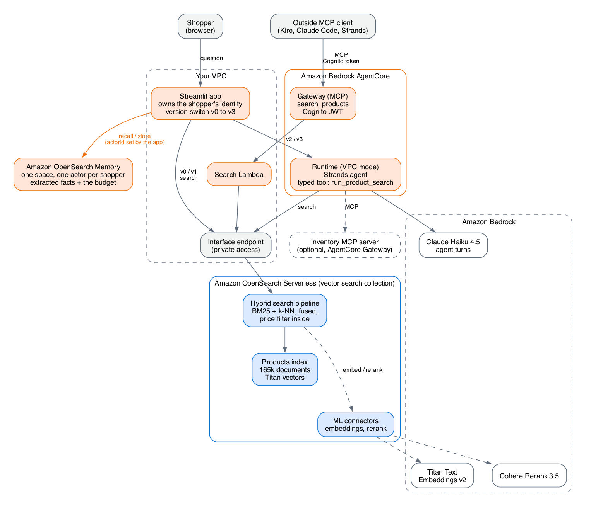
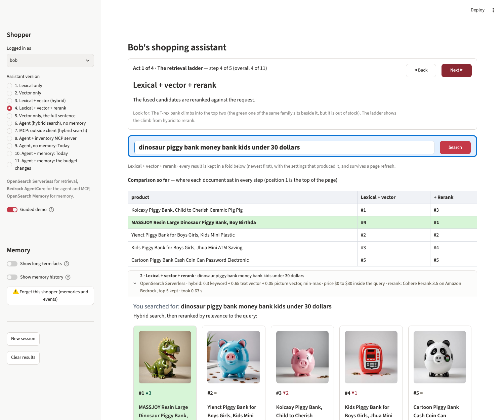

# Agent retrieval with Amazon OpenSearch Serverless

A sample retail shopping assistant that shows how far an agent's answers improve when its retrieval does. It runs on
**Amazon OpenSearch Serverless** (a vector search collection), **Amazon Bedrock AgentCore** (the hosted agent and an MCP
gateway) and **Amazon OpenSearch Memory** (long-term, per-shopper memory), with foundation models from **Amazon Bedrock**.

> **Sample code for non-production use.** This repository deploys into a non-production AWS account, uses a public
> product dataset and made-up shoppers, and holds no customer data. Work with your security and legal teams to meet your
> organizational security, regulatory and compliance requirements before any deployment of your own. See
> [docs/threat-model.md](docs/threat-model.md) and [docs/limitations.md](docs/limitations.md).





## What you get

A Streamlit app with six switchable versions of the same assistant. The app keeps every answer in a fold, with the
settings that produced it, so you can compare versions side by side.

| Version | What it adds | Where it runs |
|---|---|---|
| Keyword | BM25 over the text fields | the collection |
| v0, vector only | embeds the query, k-NN, applies the price limit *after* retrieval | the collection |
| v1, hybrid | BM25, k-NN on the text and k-NN on the product pictures, fused, with the price filter *inside* the query; optional rerank | the collection |
| v2, agent | an agent decides when to search and writes the answer from the documents it finds | AgentCore Runtime |
| v3, agent and memory | the app recalls what it knows about this shopper before the turn and stores the conversation after it | AgentCore Runtime and OpenSearch Memory |
| MCP, outside client | an outside agent (Kiro, Claude Code, Strands) reaches the same search through an MCP gateway | AgentCore Gateway |

Also in the box:

- A **guided demo** that walks the versions in order with one running comparison table.
- An optional **inventory MCP server** that the agent calls as an MCP client (`check_stock`, `delivery_estimate`).
- A **retrieval evaluation** that scores each variant on 8,939 real shopper queries.
- Infrastructure as code (CloudFormation) for the collection, the AgentCore gateway, the search Lambda and an optional app host.
- A [threat model](docs/threat-model.md) with a Threat Composer export, and unit, integration and end-to-end tests.

## What the demo shows

Bob is shopping for his six-year-old nephew's birthday: a dinosaur piggy bank under 30 dollars. The guided demo follows one product,
a T-rex bank, through four acts: the **retrieval ladder** (keyword, vector, hybrid, rerank: the bank climbs from missing to
1st), the **agent** that chooses its own query, **tools over MCP** in both directions, and **memory across sessions** (Bob
returns, the assistant remembers Sunday, and his budget changes from 30 to 40 dollars). Open it with `?guided=1`. Every
step, what to type and what to look at is in [docs/guided-demo.md](docs/guided-demo.md).

## How it works, in one paragraph

The app, not the model, owns the shopper's identity: it sets the memory `actorId` on every call, so the model can never
choose whose memory it reads. For a v3 turn the app recalls the shopper's facts from OpenSearch Memory, sends the question
and the facts (marked as data, not instructions) to the agent on AgentCore Runtime, and stores the exchange afterwards.
The agent has one typed tool, `run_product_search`; the runtime builds the hybrid query in code, so the model never writes
query DSL. See [docs/architecture.md](docs/architecture.md).

## Measured results

8,939 real shopper queries from the Amazon Shopping Queries (ESCI) dataset (the whole US small test split), scored at the
top 5 results on the collection ([method and intervals](docs/results/retrieval-eval-serverless.md)):

| Variant | NDCG@5 |
|---|---|
| Vector only | 0.482 |
| Keyword | 0.451 |
| Hybrid | 0.507 |
| Hybrid + rerank, 5 candidates reranked | 0.515 |
| Hybrid + rerank, 20 candidates reranked | 0.549 |
| Hybrid + rerank, 50 candidates reranked | 0.553 |

Rerank helps most when it is given more candidates than you keep. These scores are for the configuration in this repository:
hybrid with keyword 0.3, text vector 0.65 and picture vector 0.05, fetching a window of 20 and keeping 5. They are single
runs on one account (`us-east-1`, 22 November 2026), so measure on your own queries before relying on them.

## Prerequisites

- A **non-production AWS account** and the [AWS CLI v2](https://docs.aws.amazon.com/cli/latest/userguide/getting-started-install.html)
  with credentials that can create IAM roles, CloudFormation stacks, an OpenSearch Serverless collection, AgentCore
  resources and an OpenSearch Memory space.
- The [Session Manager plugin](https://docs.aws.amazon.com/systems-manager/latest/userguide/session-manager-working-with-install-plugin.html)
  for the AWS CLI. The collection is private, and you reach it through an SSM port forward.
- Python 3.11 or newer and, to redraw the diagrams, [Graphviz](https://graphviz.org/download/).
- A VPC with three private subnets (one per Availability Zone) and a route to the internet through a NAT gateway.
  [docs/setup.md](docs/setup.md) shows how to create one with the optional `infra/serverless/network.yaml`.
- Amazon Bedrock model access in your account for Titan Text Embeddings v2, Titan Multimodal Embeddings (in `us-east-1`
  or `us-west-2`), Cohere Rerank 3.5 and Claude Haiku 4.5.
- **A Region that offers every service the sample uses:** Amazon OpenSearch Serverless (vector search collections), Amazon
  Bedrock AgentCore (Runtime and Gateway), Amazon Bedrock with Titan Text Embeddings v2 and Claude Haiku 4.5, and at least
  three Availability Zones. Pick it with `OS_REGION` (`us-east-1` in the examples).
- Amazon OpenSearch Memory is available in `us-east-1`, `us-west-2`, `ap-northeast-1` and `eu-central-1` only. The memory
  space is created in your Region if it is one of those, and otherwise in `us-east-1` (set `MEMORY_REGION` to choose).
  Cohere Rerank and Titan Multimodal Embeddings are called in the Regions you set (`RERANK_REGION`, `MULTIMODAL_REGION`).

## Quick start

The full, ordered guide with every parameter is [docs/setup.md](docs/setup.md). In short:

```bash
python -m venv .venv && source .venv/bin/activate
pip install -e ".[dev]"                  # add the e2e extra for the browser checks: pip install -e ".[e2e]"
cp config/.env.example .env                  # then edit it once the collection exists: OS_HOST and the role ARN (docs/setup.md)

# 1. The collection, its private endpoint, its policies and the Bedrock connector role (about 10 minutes)
aws cloudformation deploy --stack-name sample-agent-ret-collection --template-file infra/serverless/collection.yaml \
  --capabilities CAPABILITY_NAMED_IAM \
  --parameter-overrides VpcId=<vpc> SubnetIds=<subnet-a>,<subnet-b>,<subnet-c> ClientCidr=<vpc cidr> \
  DataPrincipalArns=<your role arn>

# 2. Reach the private endpoint from your machine (leave this running in its own terminal)
scripts/port_forward.sh <ssm-managed-instance-id> <vpce-dns-name> 9301

# 3. Connectors, models, pipelines and the index
python infra/serverless/deploy_objects.py

# 4. The catalog: about 165,000 products from the public ESCI dataset, and a vector for each product picture
#    (an hour or more, resumable; see docs/setup.md)
python scripts/load_catalog.py
python scripts/add_demo_product.py

# 5. The AgentCore side: the memory space, the search gateway and the hosted agent
python infra/serverless/deploy_agentcore.py --no-inventory

# 6. Run the app
streamlit run src/retail_agent_demo/app.py
```

Delete everything when you are done: see [Clean up](docs/setup.md#clean-up). An OpenSearch Serverless collection and an
AgentCore runtime bill while they exist; [docs/cost-model.md](docs/cost-model.md) lists what to expect.

## Repository layout

```
src/retail_agent_demo/   the app and its libraries (search, agent calls, memory, UI tables)
infra/serverless/        CloudFormation (collection, AgentCore gateway and Lambda, optional VPC and app host), deploy scripts,
                         the hosted agent (agentcore/main.py), index and pipeline definitions
infra/cloudformation/    the optional inventory MCP gateway
infra/ec2/               installs the app as a service on the optional host
scripts/                 catalog loader, evaluation, validation, port forwards, diagrams
config/                  .env and ids examples (real values are never committed)
docs/                    setup, architecture, configuration, operations, cost, limitations, threat model, results
tests/                   unit tests (no network) and integration tests (your deployed stack)
```

## Run and test

```bash
streamlit run src/retail_agent_demo/app.py          # the app, on http://localhost:8501
python scripts/sls_reset_demo_memory.py --user bob  # put the demo shopper back to "Sunday" (deletes that shopper's memory first)

pytest tests/unit                                   # no network needed
RUN_INTEGRATION=1 pytest tests/integration         # needs your deployed stack and the port forward
python scripts/validate_demo.py --url http://localhost:8501   # end to end, in a real browser (pip install -e ".[e2e]" and playwright install chromium)
```

To reproduce the retrieval measurements (several hours and some Bedrock cost, see the cost model):

```bash
python scripts/prepare_esci_judgments.py --queries 9000 --out data/esci_full.json
python scripts/eval_retrieval.py --sample data/esci_full.json --queries 9000 --workers 10
```

## Data

Product text and relevance judgments come from the
[Amazon Shopping Queries (ESCI) dataset](https://github.com/amazon-science/esci-data), Apache-2.0, which is not
distributed with this repository. Prices and stock are synthetic (`price_synthetic: true`), derived from the product
ID; a few story products are set by hand. The 380 product pictures in `assets/products` were generated for this sample
with Stable Image Core on Amazon Bedrock (`scripts/generate_product_images.py`) from product titles; they are illustrations, not photographs of the products. Each
picture is also embedded with Titan Multimodal Embeddings, so a text query can match what a picture shows.

## Documentation

- [Documentation index](docs/README.md)
- [Setup guide](docs/setup.md): every step, with prerequisites, parameters, checks and clean-up
- [The guided demo](docs/guided-demo.md): the story and its eleven steps
- [Configuration reference](docs/configuration.md): `.env` and `config/ids.json`
- [Architecture](docs/architecture.md): components, flows and the diagrams
- [Operations](docs/operations.md): running, scaling, logs and troubleshooting
- [Cost model](docs/cost-model.md) and [limitations](docs/limitations.md)
- [Threat model](docs/threat-model.md), [generative AI use](docs/generative-ai.md), [dependency licenses](docs/dependency-licenses.md)
- [Measured results](docs/results)

## Security

See [CONTRIBUTING](CONTRIBUTING.md#security-issue-notifications) for more information on reporting security issues.

## Contributing

Contributions are welcome. See [CONTRIBUTING.md](CONTRIBUTING.md) for guidelines on proposing new samples, reporting issues, and submitting pull requests.

## License

Apache-2.0. See [LICENSE](LICENSE) and [NOTICE](NOTICE).
