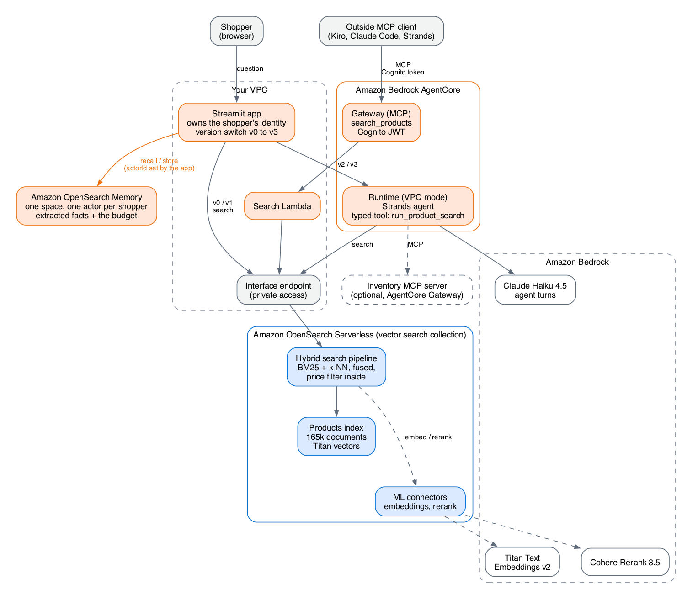
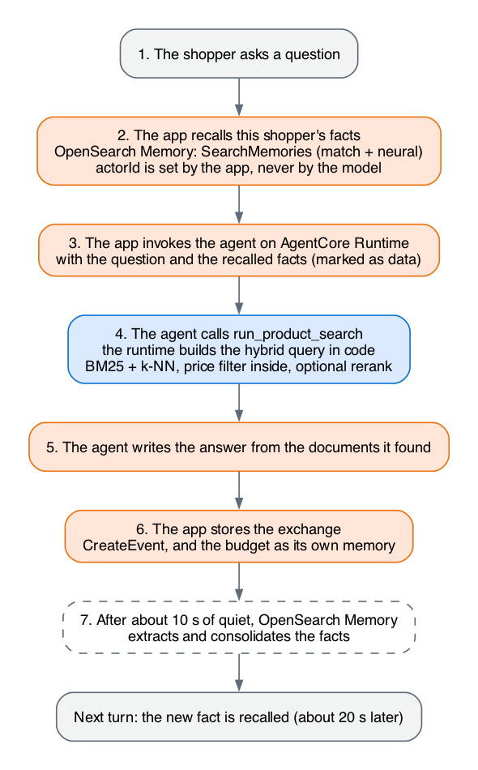
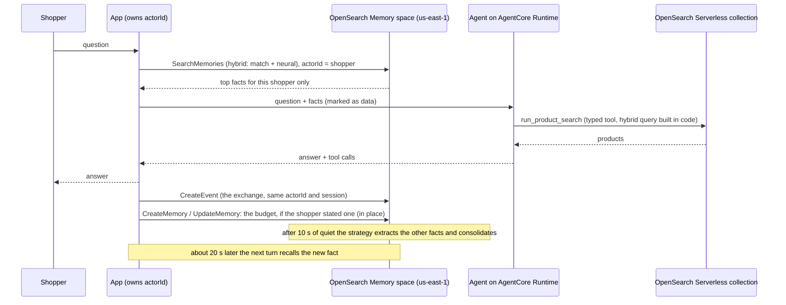

# Architecture

The app owns the shopper's identity. **Amazon OpenSearch Serverless** holds the catalog and runs hybrid search,
**Amazon Bedrock AgentCore** hosts the agent and an MCP gateway, **Amazon OpenSearch Memory** keeps what the assistant
learns about each shopper, and **Amazon Bedrock** supplies the models.

Sources: [architecture.dot](diagrams/architecture.dot) and [request-flow.dot](diagrams/request-flow.dot). Rebuild the pictures
with `python scripts/build_diagrams.py` (needs Graphviz).

## Components

| Component | What it is | Where in the code |
|---|---|---|
| Streamlit app | The UI and the orchestrator: it sets the shopper's `actorId` on every memory call, recalls and stores memory around each agent turn, and runs the plain search versions itself. | `src/retail_agent_demo/app.py` |
| Collection | An OpenSearch Serverless vector search collection with a private interface endpoint. One index holds about 165,000 products with a text vector (Titan v2, 1024 dimensions), the text fields, and for the roughly 380 products that have a generated picture a picture vector (Titan Multimodal Embeddings, 1024 dimensions). | `infra/serverless/collection.yaml`, `infra/serverless/opensearch/` |
| ML connectors | Connectors and remote models on the collection that call Bedrock for text embeddings (Titan Text Embeddings v2), picture and query embeddings in the picture space (Titan Multimodal Embeddings) and rerank (Cohere Rerank 3.5), through one IAM role. | `infra/serverless/deploy_objects.py` |
| Search pipelines | The ingest pipeline embeds documents. The search pipelines fuse the keyword score and two k-NN scores, one on the text vectors and one on the picture vectors (min-max normalization, weights 0.3, 0.65 and 0.05), and, in the second one, rerank. | `infra/serverless/opensearch/` |
| AgentCore Runtime | Hosts the agent: a Strands agent with one typed tool, `run_product_search`. The runtime builds the hybrid query in code and calls the collection through the interface endpoint (VPC mode). | `infra/serverless/agentcore/main.py` |
| AgentCore Gateway | An MCP endpoint with Cognito JWT authorization. Its target is a Lambda in the VPC that searches the collection. This is the "outside MCP client" path. | `infra/serverless/agentcore.yaml` |
| OpenSearch Memory | One space, one actor per shopper. Events record the conversation; a prompt-based strategy extracts and consolidates facts. The budget is written by the app as a memory of its own. | `src/retail_agent_demo/osmemory.py` |
| Inventory MCP server | Optional. A second gateway with synthetic `check_stock` and `delivery_estimate` tools that the agent calls as an MCP client. | `infra/cloudformation/inventory-gateway.yaml`, `infra/inventory_mcp/` |

## Why the app owns identity and memory

The model never chooses whose memory is read. The app sets the `actorId` on every call, and the app role's IAM policy
allows memory actions only for calls that name an actor (the `osm:actorId` condition key). Memory extraction is asynchronous
and belongs to the service, so the app brackets each agent turn: recall before, store after.

## One v3 turn

## The versions

| Version | Path | Notes |
|---|---|---|
| Keyword | app, collection | BM25 over title, bullet points, description, brand and color. |
| v0 vector | app, collection | Embeds the query with Titan v2 through the connector and runs k-NN (k = 50). The price limit is applied by the app *after* retrieval, so fewer than five results can remain. |
| v1 hybrid | app, collection | The hybrid query (keyword, text vector, picture vector), with the price filter inside it, through the search pipeline. The picture clause embeds the shopper's words with the multimodal model and matches them against picture vectors, so it only affects products that have a picture. |
| v1 + rerank | app, collection, Bedrock | The same, then Cohere Rerank 3.5 scores the fused candidates against the shopper's words. Rerank is quota-limited per Region, so the app falls back to plain hybrid when it is throttled. |
| v2 agent | app, runtime, collection | The agent decides whether and what to search. |
| v3 agent and memory | app, memory, runtime, collection | v2 plus recall before the turn and store after it. |
| MCP outside client | app, gateway, Lambda, collection | An outside agent reaches the same search over MCP. The app plays that client, with its own Cognito token. |

## Network and access

- The collection admits only its own interface endpoint (network policy). Reading and writing also needs an entry in the
  data access policy, which lists named roles: the search Lambda's, the runtime's and the app's.
- The endpoint's security group takes port 443 from `ClientCidr` only. The Lambda and the runtime allow 443 out only.
- Requests to the collection are SigV4-signed (`aoss`). There are no passwords.
- The collection is encrypted with an AWS-owned key. See [limitations.md](limitations.md) for what to change for production.
- Cohere Rerank is called in `RERANK_REGION` (`us-east-1` by default; the model is not offered in every Region), and the picture model in `MULTIMODAL_REGION`.

## Design decisions

- **The app owns identity.** The model never chooses whose memory is read, and the IAM policy only allows memory calls that
  name an actor.
- **A typed tool, not model-written queries.** The agent fills in a query and a price range. The runtime builds the hybrid
  query, so the model cannot add clauses or reach other indices.
- **One hybrid query with a fixed fusion.** Keyword 0.3, text vector 0.65 and picture vector 0.05, min-max normalized. The
  weights come from an experiment, not from a re-run of the full evaluation (see [limitations](limitations.md)).
- **Rerank inside the engine, against the shopper's own words,** with a fallback to plain hybrid when Bedrock throttles it.
- **A private collection.** It is reachable only through its interface endpoint, and every request is SigV4-signed.
- **OpenSearch Memory for long-term memory.** It extracts facts asynchronously, keeps no change log, and exists in four
  Regions. The app writes the shopper's budget itself, so a changed budget replaces the old one instead of competing with it.
- **Haiku for the agent's turns,** which keeps an answer to a few seconds. Pass `--agent-model-id` to try another model.

The security view is in the [threat model](threat-model.md).
